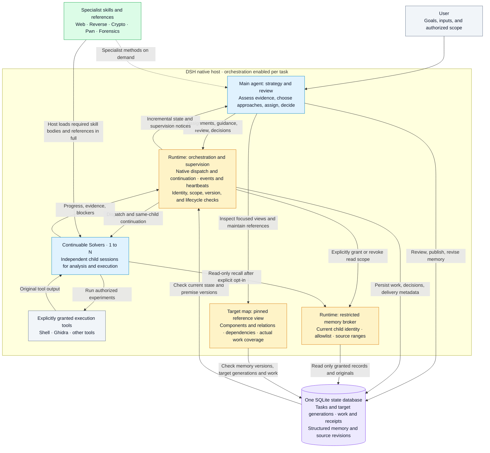

# DSH-CTF-Skill

[简体中文](README.md) | **English** | [日本語](README.ja.md)


> **Turn your DeepSeek into a full-stack CTF team.**

CTF and security analysis skills for [DeepSeek Harness (DSH)](https://github.com/deepseek-ai/deepseek-harness), covering Web, reverse engineering, cryptography, Pwn, and traffic forensics, with optional orchestration of continuable Solvers, structured memory, evidence review, and durable task state.

[](LICENSE) [](https://www.npmjs.com/package/@deepseek-ai/dsh)

[Quick start](docs/QUICKSTART.md) · [Runnable examples](examples/README.md) · [Download Preview](https://github.com/Cristallin2006/DSH-CTF-Skill/releases/tag/v0.7.0) · [Changelog](CHANGELOG.md) · [Contribute](CONTRIBUTING.md)

**Try one command first:** `python3 examples/recovery/run.py` (Python 3.10+ only; use `python` on Windows). This synthetic byte-recovery example makes zero model calls. A native Solver/memory walkthrough is also included. Choose skills-only or full orchestration installation; the installer previews by default. See the [quick start](docs/QUICKSTART.md).

The model chooses how to investigate. The runtime maintains task identity, evidence references, resources, and lifecycle state. Skills provide specialist methods. Simple tasks can use skills directly; complex tasks with independent branches can opt into dedicated orchestration.

**TSecBench v1 local mode (2026-10-18): composite score 96.94, 22300 points earned, and 71/74 correct flags.** See [local benchmark records](#local-benchmark-records).

This README covers the same overview as the [Chinese version](README.md). Linked skills and detailed reference documents are primarily in Chinese.

## Local multi-stage analysis (experimental, 2026-10-24)

Optional [relay session contracts](skills/pwn-exploit/references/relay-session-contracts.md) and [process/result observations](skills/re-dynamic/references/process-observation.md) add offline framing, injected tunnels, read-only worker/load-bias snapshots and saved-output receipts. No automatic connection, cleanup or acceptance inference. Main only; no new benchmark claim.

Main includes optional [SQLite extension](skills/pwn-exploit/references/sqlite-extension.md), [seccomp evidence](skills/pwn-exploit/references/seccomp-evidence.md) and [local multi-stage](skills/pwn-exploit/references/multi-stage-local.md) methods. Static tools never execute samples; the Linux lab supports owned children with configurable private paths. No general resource adapter or mandatory solving gate is enabled. Not in the v0.7.0 archive; no new benchmark claim.

## Windows user-mode analysis (experimental, 2026-10-23)

Cross-platform PE metadata triage and optional Windows references now connect to a native Windows x64 Python observer for explicitly launched x64/WOW64 children. It records exceptions, registers, modules, raw stack bytes and process policies. Static declarations are not runtime enforcement; stack bytes are not an unwound call stack. No fixed backend order, automatic policy changes or extra Solver permissions. See the [overview](skills/pwn-exploit/references/windows-pwn.md) and [debugging contract](skills/re-dynamic/references/windows-debug-channel.md) (Chinese). On main, not in the existing v0.7.0 archive; no new benchmark claim.

## Optional knowledge discovery and project methods (experimental, 2026-10-22)

`dsh_knowledge` offers bilingual reference navigation with matching reasons, prerequisites and counterexamples. Explicitly reviewed, redacted method cards can be reused across tasks in the same workspace. Lookup and adoption are optional; changed sources require rechecking. No automatic skill edits or additional Solver permissions. See the [contract (Chinese)](skills/analysis-memory/references/knowledge-library.md). Available on main, not in the existing v0.7.0 Preview archive; no new benchmark claim.

## Long tasks and complete materials (main)

Cumulative work and map-key caps are removed. Long assignments, followups and received results retain full text with paged access; large unresolved sets use versioned batches. Critical constraints and required skill materials remain complete or explicitly blocked; large files use authorized input references. See the [contract (Chinese)](skills/analysis-orchestration/references/long-tasks.md). This update is not in the existing v0.7.0 Preview archive and makes no new benchmark claim.

## Experimental target map (2026-10-21)

The coordinator can view target structure, goal dependencies and actual objective-bound work through a parent-only reference map. Nodes and edges pin original memory revisions, preserving conditions, uncertainty, conflicts and invalidation. Focused, bounded pages do not expand Solver grants or prove connectivity, permission or completion. Simple tasks need no map. See the [contract (Chinese)](skills/analysis-orchestration/references/target-map.md).

Available on main; not included in the existing v0.7.0 Preview archive. No new benchmark result is claimed.

## Knowledge update (2026-10-21)

This update is on `main` and is not included in the existing v0.7.0 Preview download. Use the current branch source to try it.

Static RE, Crypto, Web and Pwn now declare small core reference cards delivered in full for selected Solver skills. Topic material stays on demand and other skills remain callable. Initial legacy references now distinguish technical requirements from heuristics. Format checks support explicit Base64 contracts and preserve binary/newline input. See [knowledge checks and CLI compatibility](tests/knowledge/README.md). This is not a new benchmark result.

## Architecture

The diagram shows responsibilities and data flow when orchestration is enabled. Simple tasks can use skills in the main agent without starting a Solver.



- **Models make judgments:** the main agent plans and reviews; Solvers analyze and execute independently. Agreement or a successful tool call does not automatically establish a correct conclusion.
- **Skills provide methods:** required skill bodies and reference cards are delivered in full before Solver inference. Other skills remain discoverable on demand. Knowledge does not grant execution permissions.
- **Memory has an explicit scope:** the main agent reviews and publishes. A Solver receives restricted read access only if that capability was reserved in its initial assignment. Ordinary memory write tools are not delegated. Optional Observers have no tools.
- **State closes the loop:** work, grants, delivery, and read receipts use the same state database. Important premise changes invalidate old decisions. Task completion requires current evidence checks; restart restores metadata without replaying execution.

See [host plugins](plugins/README.md) for implementation and installation, the [orchestration skill](skills/analysis-orchestration/SKILL.md) for assignments and skill delivery, and the [collaborative reasoning contract](skills/analysis-orchestration/references/collaborative-memory.md) for memory grants and second-angle review.

## Updates (2026-10-19)

- **Experimental orchestration 0.7.0:** the main agent handles strategy, dispatch, and review; continuable Solvers execute substantive work. Events and heartbeats support supervision, guidance grounded in evidence, and confirmed cancellation.
- **Premise invalidation:** changes to explicitly registered memory premises or their sources invalidate old completion decisions. Unrelated memory updates do not repeatedly reopen every decision.
- **Scoped memory and second-angle review:** Solvers recall only explicitly granted reviewed records and originals. Neutral handoffs and neutral continuation in the same child are supported. Reading an original is recorded separately from understanding or verification.
- **Continuation in the same child:** a returned Solver can remain idle; `followup` resumes its identity and history. There are no default task/run deadlines, step caps, or cumulative wake-up caps. Model context limits, individual tool limits, and resource leases still apply.
- **Explicit decisions after idle:** record continue, waiting, blocked, deferred, or complete. `finish` ends the orchestration stage; overall task completion requires a current scope and evidence assessment. Goal, constraint, result, or key evidence changes invalidate old assessments.
- **More precise handoffs and negative evidence:** distinguish user constraints, coordinator phases, hypotheses, and suggestions. Login diagnostics, reused failures, and coverage assessments state what was actually ruled out.
- **Lifecycle fixes:** detach stale cancellation listeners and drain work before unloading to prevent late callbacks from accessing a closed database.
- **Data-driven recovery:** added knowledge on layouts, comparison direction, compound transforms, and evidence validation, plus a local finite search tool with explicit parameter ranges, budgets, equivalence deduplication, and replayable candidates. See [data recovery](skills/ghidra-static/references/data-driven-recovery.md) and the [pipeline contract](skills/ghidra-static/references/transform-pipelines.md).

The host loads required skills and the complete reference cards declared by `skill-materials.json` before child inference and records visibility. A brief does not replace original material; other skills remain available on demand. New Solvers must declare `skill_plan` and `execution_plan`. An explicit `objective_ref` prevents reopening the same objective under a different key. Queries default to summaries and incremental pages. Missing execution capabilities or an unsupported path for hard quotas blocks dispatch; there is no universal resource-cleanup interceptor. See [reliable work](skills/analysis-orchestration/references/reliable-work.md) and [skill delivery](skills/analysis-orchestration/references/skill-delivery.md) for fields and legacy-work migration.

This release does not claim a benchmark improvement or that multiple agents always outperform one. Orchestration is intended for independent execution or review where handoff costs are manageable.

## Repository layout

| Path | Purpose |
|---|---|
| `skills/ctf-web`, `ctf-misc`, `ctf-crypto` | Web, Misc, and cryptography knowledge and diagnostics |
| `skills/traffic-analysis` | pcap triage, covert channels, USB HID, WPA/TLS |
| `skills/ghidra-core`, `ghidra-static` | Ghidra headless RPC engine and static analysis |
| `skills/re-*`, `vuln-audit`, `android-re`, `pwn-exploit` | Reverse engineering, dynamic validation, code analysis, Android, and Pwn; shares origins with [ghidra-skill-for-dsh](https://github.com/Cristallin2006/ghidra-skill-for-dsh) |
| `skills/analysis-session`, `analysis-memory` | Tasks, target generations, evidence, resource leases, structured memory, and material handoff |
| `skills/analysis-orchestration` | Methods and contracts for dedicated orchestration, continuable Solvers, supervision, and completion assessment |
| `runtime/analysis-v1` | Python/SQLite runtime; session version 1.0.8 |
| `plugins/` | Host plugins for state, memory, optional request control, and experimental orchestration |
| `dsh-hooks/` | Session cards, state hooks, configuration snippets, and merge scripts |
| `tests/` | Isolated synthetic regressions without external models or live targets |

## Installation (WSL / Linux)

Specialist skills require their corresponding tools. Plugins were validated locally on **Linux/WSL, Node.js 24.21.0, DSH 0.1.5-rc.3, and Python 3**; the Python runtime requires 3.10+. The reverse-engineering engine additionally requires Ghidra 12.x and JDK 21+. See [TOOLSET.md](TOOLSET.md). Native Windows integration was not part of this release's acceptance testing.

Back up existing directories before replacing them. When upgrading plugins, pause tasks, confirm child cleanup, and perform a maintenance restart. Do not overwrite newer task state with an old database.

```bash
python3 tools/doctor.py --mode skills
python3 tools/setup.py --mode skills          # preview
python3 tools/setup.py --mode skills --apply  # install
```

Copying skills alone does not install runtime tools. State, memory, and orchestration also require plugin registration, hooks, and a dedicated state directory; see [plugin installation](plugins/README.md). This repository does not distribute personal profiles, model keys, task databases, or a machine-private `TOOLCHAIN.md`. Public tool selection and discovery guidance is in [TOOLSET.md](TOOLSET.md).

## How orchestration works

1. The main agent reads the `analysis-orchestration` skill, binds a task with `analysis_session init/bind`, and opens memory with `dsh_memory_write open`.
2. After `dsh_orchestration enable`, the main agent retains reading, state, and memory tools; the runtime restricts direct execution and alternative dispatch channels. `add` declares the question, inputs, criteria, and execution tools. `dispatch` starts a Solver without blocking.
3. Solvers receive `skill` and their feedback tool by default. They can load installed, callable specialist skills on demand; execution tools must be explicitly granted. They do not inherit the main agent's full conversation or already loaded skill bodies. Optional Observers have no tools and only review supplied material.
4. The main agent supervises through `wait/status/result/trace` and uses `steer/followup` to supply material, guide, or continue work. A Solver may disagree with evidence. Returned results require `review`; revised adopted results require a new review.
5. Once all work is idle, use `status.decision_review.signature` with `resolve` to record the decision, unresolved issues, and evidence. `finish/disable` can end a stage; overall task `complete` requires the latest completion assessment and cannot be bypassed with an empty unresolved list.

Fields and examples are documented in the [orchestration skill](skills/analysis-orchestration/SKILL.md), [supervision contract](skills/analysis-orchestration/references/supervision.md), and [goal resolution](skills/analysis-orchestration/references/resolution.md). The tool's `schema` action returns current fields. Pause or restart does not replay work automatically; inspect state before explicitly resuming.

## Boundaries and known limitations

- Orchestration is experimental and enabled per task. It depends on DSH's native `startContinuable/sendMessage/drainContinuableChildren` interfaces and lifecycle events. Other DSH versions require compatibility validation. It does not expand sandbox, approval, tool, or recursive delegation permissions.
- Default concurrency is 2 per task and a host cap of 3. Stored summaries are bounded; results beyond 32768 characters are marked truncated. Full material requires readable files or chunked `dsh_handoff` delivery. Child context capacity depends on the actual model and host; a fixed 1M context is not promised.
- `adopted`, a successful tool call, and a completion assessment do not establish independent verification or target acceptance. A reference's existence does not prove a conclusion. Negative findings must state tested conditions and remaining gaps.
- **Request control is an optional host policy:** after policy import, controlled sessions must send HTTP(S) through `dsh_control`, which manages budgets, rates, origins, and credential references. Ordinary shell, browser, and MCP paths do not have global per-request accounting. Strict HTTP control does not currently support executable Solvers; orchestration refuses to enable rather than bypassing that control.
- Under extreme cancellation, a native hook subprocess startup failure was observed to leave host exit waiting unfinished; its root cause remains unconfirmed. This release fixes orchestration database shutdown ordering, not every native hook shutdown problem. Production hooks were not disabled.

## Validation

Run in WSL/Linux:

```bash
python3 tests/run.py
# Independent synthetic recovery tests: Python only, no model service
python3 tests/recovery.py
# Optional native-host tests: requires installed DSH; run in the same terminal
export DSH_NATIVE_PACKAGE_ROOT="$(npm root -g)/@deepseek-ai/dsh"
python3 tests/run.py --native
```

Base regressions cover handoffs, feedback, default budgets, versioned decisions, task isolation, and database shutdown. Native regressions also cover plugin reloads, idle Solver notifications to the parent, same-child continuation, skills, and permissions. Local 0.7.0 acceptance passed 15 synthetic/native groups, 2 installed-path groups, and isolated Web startup/shutdown; recovery tooling has 13 additional Python tests. Tests use deterministic local model adapters and isolated temporary state, without reading real solving sessions or calling configured model services. They verify mechanisms, not real-model solving effectiveness. Reports go to ignored `.test-results/`; temporary fixtures remain in the system temporary directory for debugging.

## Local benchmark records

The latest result comes from a user-supplied **TSecBench v1 local-mode** screenshot, dated **2026-10-18 18:48**. The assistant is **dsh**, and the model label is **Deepseek**.

| Test time | Points earned | Composite score | Displayed completion | Correct flags | Fully correct tasks |
|---|---:|---:|---:|---:|---:|
| **2026-10-18 18:48 (local mode)** | **22300** | **96.94** | **95.9%** | **71/74** | **61/63** |
| 2026-10-14 (earlier local record) | 21215 / 23000 | 91.94 | 93.2% | 69/74 | 61/63 |

Latest category results:

| Category | Fully correct tasks | Remaining results |
|---|---:|---|
| Web vulnerability discovery | 18/18 | All fully correct |
| Binary vulnerability discovery | 13/13 | All fully correct |
| Exploitation | 8/9 | 1 task scored zero |
| Multi-stage penetration testing | 2/3 | 1 task partially correct |
| Cloud attacks | 6/6 | All fully correct |
| Adversarial evasion | 14/14 | All fully correct |

Metrics are recorded separately as displayed: composite score, raw points, displayed completion, flags, and fully correct tasks are not converted into one another. Local-mode results are not official leaderboard results. The screenshot does not identify an exact model version or code revision, so it cannot establish a gain attributable to 0.7.0 or a particular change. The repository does not contain a complete independently reproducible evaluation package.

Models, tools, target state, and orchestration versions can affect results. The design supports general analysis workflows rather than platform-specific task IDs, fixed scanning lists, enumeration counts, or mandatory use of all available time.

## License and acknowledgments

Original code is released under [MIT](LICENSE); included or derived content retains applicable upstream licensing. Direct sources, architectural references, and knowledge synthesis are listed separately in [THIRD_PARTY_LICENSES.md](THIRD_PARTY_LICENSES.md). Orchestration draws on mechanisms from BreachWeave, the inspected ARTEX `artex-global` version, and Microsoft Magentic, using an independent implementation on DSH's native interfaces.

### Collaborative reasoning and scoped memory (0.7.0)

Adds explicit premise version checks, read-only memory/original recall scoped to native Solver identity, and second-angle contracts with optional neutral handoff. Legacy work without a reserved capability is not expanded; Observers have no tools, and idle grant changes do not run a model. The new recall tool supports reviewed records and `src-*` snapshots; `doc-*` originals continue through the existing handoff channel. Offline synthetic acceptance does not establish a benchmark gain. See [permissions, boundaries, and usage](skills/analysis-orchestration/references/collaborative-memory.md).
