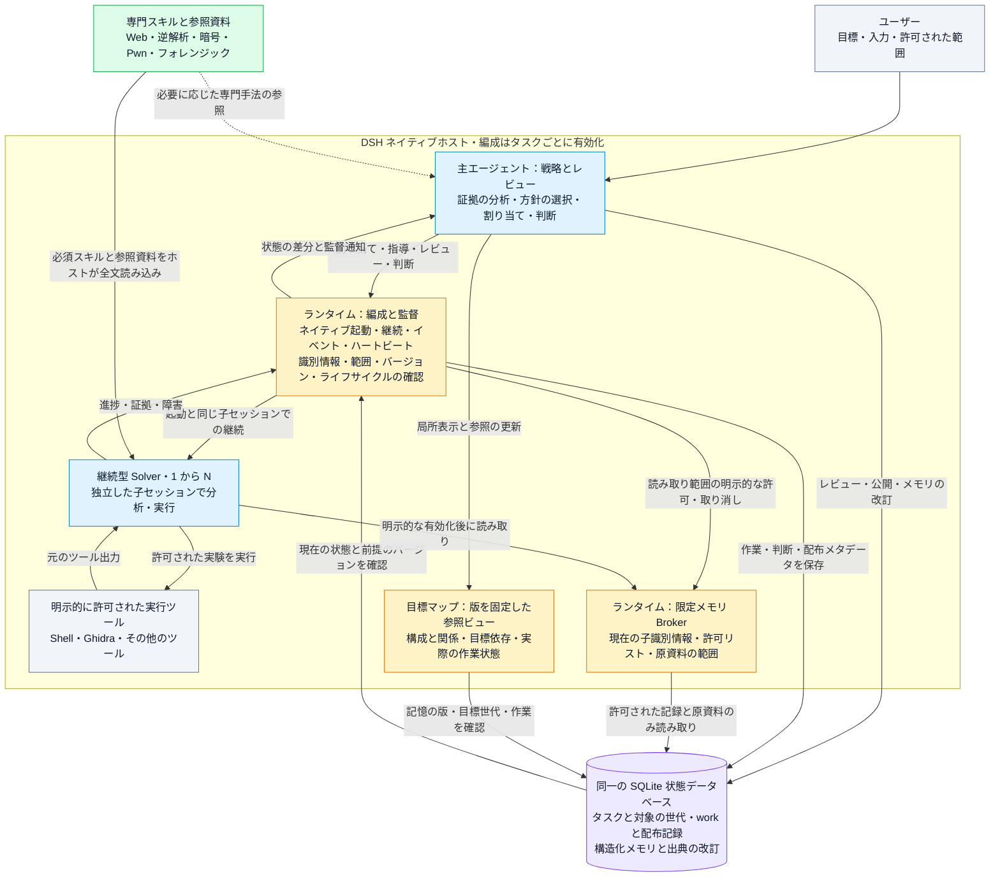

# DSH-CTF-Skill

[简体中文](README.md) | [English](README.en.md) | **日本語**


> **あなたの DeepSeek を、フルスタック CTF チームに。**

[DeepSeek Harness（DSH）](https://github.com/deepseek-ai/deepseek-harness) 向けの CTF・セキュリティ分析スキル集です。Web、リバースエンジニアリング、暗号、Pwn、通信解析などを扱い、継続型 Solver の編成、構造化メモリ、証拠のレビュー、永続的なタスク状態管理をオプションで利用できます。

[](LICENSE) [](https://www.npmjs.com/package/@deepseek-ai/dsh)

[クイックスタート](docs/QUICKSTART.md) · [実行例](examples/README.md) · [Preview をダウンロード](https://github.com/Cristallin2006/DSH-CTF-Skill/releases/tag/v0.7.0) · [変更履歴](CHANGELOG.md) · [貢献ガイド](CONTRIBUTING.md)

**まず 1 コマンドで体験：** `python3 examples/recovery/run.py`（Python 3.10+ のみ。Windows は `python`）。外部モデルを呼ばない合成データの復元例です。原生 Solver とメモリ権限の実行例もあります。スキルのみ・完全な編成機能の 2 モードを選べ、インストーラーは既定でプレビューのみを行います。[入門ガイド](docs/QUICKSTART.md)をご覧ください。

分析方針はモデルが選び、ランタイムはタスクの識別情報、証拠参照、リソース、ライフサイクルを管理します。スキルは専門的な手法を提供します。単純なタスクではスキルを直接利用し、独立した作業に分割できる複雑なタスクでは専任の編成機能を有効にできます。

**TSecBench v1 ローカルモード実測（2026-10-18）：総合スコア 96.94、獲得点数 22300、正解 Flag 71/74。** 詳細は[ローカルモードの評価記録](#ローカルモードの評価記録)をご覧ください。

この README は[中国語版](README.md)と同じ概要を説明しています。リンク先のスキル本文と詳細資料は主に中国語です。

## 多段階ローカル解析（実験的、2026-10-24）

任意の[中継セッション契約](skills/pwn-exploit/references/relay-session-contracts.md)と[プロセス・結果観測](skills/re-dynamic/references/process-observation.md)を追加しました。オフライン分帧、注入式トンネル、読み取り専用 worker/load bias、保存済み出力の回収に限定し、自動接続・終了や候補からの受理推定は行いません。main のみで、新しいスコアの主張はありません。

main に任意で選択する [SQLite 拡張](skills/pwn-exploit/references/sqlite-extension.md)、[seccomp の証拠](skills/pwn-exploit/references/seccomp-evidence.md)、[多段階ローカル実験](skills/pwn-exploit/references/multi-stage-local.md)を追加しました。静的ツールは試料を実行せず、Linux 実験はパスを設定できる自分の子プロセスに限定します。汎用リソース管理や必須の解法手順は追加しません。既存 v0.7.0 配布物には未収録で、新しいスコアの主張はありません。

## Windows ユーザーモード解析（実験的、2026-10-23）

PE の静的メタデータ解析と任意の Windows 専門資料を追加しました。Windows x64 Python の原生デバッグ API で、明示的に起動した x64/WOW64 子プロセスの例外、レジスタ、モジュール、スタックのバイト列、プロセスポリシーを記録できます。静的宣言は実行時の有効化を証明せず、生のスタックは展開済みコールスタックではありません。固定のバックエンド順序、ポリシーの自動変更、Solver 権限の追加はありません。[入口](skills/pwn-exploit/references/windows-pwn.md)と[調査契約](skills/re-dynamic/references/windows-debug-channel.md)（中国語）を参照してください。main の更新で、既存の v0.7.0 には未収録です。新しい評価結果はありません。

## 知識検索とプロジェクト手法メモリ（実験的、2026-10-22）

任意の `dsh_knowledge` で、中英のキーワードから専門資料を検索し、一致理由、前提、反例を確認できます。明示的に匿名化・レビューした手法カードは、同じ作業ディレクトリの別タスクでも参照できます。検索と採用は任意で、元資料の変更時は再確認が必要です。skill の自動変更や Solver の権限拡張はありません。[契約（中国語）](skills/analysis-memory/references/knowledge-library.md)を参照してください。main の更新であり、既存の v0.7.0 Preview には未収録です。新しい評価結果はありません。

## 長期タスクと完全な資料（main）

累積 work 数とマップキー数の固定上限を撤廃しました。長い指示、継続メッセージ、受信した結果は全文を保存し、ページ単位で参照できます。未解決事項は版付きのバッチで登録します。重要な制約と必須スキル資料は完全に渡すか、明示的に停止します。大きなファイルは許可された参照とツールで扱います。[契約（中国語）](skills/analysis-orchestration/references/long-tasks.md)を参照してください。既存の v0.7.0 Preview 配布物には未収録で、新しいベンチマーク結果はありません。

## 目標構成マップ（実験的、2026-10-21）

主エージェント向けの参照マップで、構成要素の関係、目標の依存関係、実際の作業状態を確認できます。ノードと辺は元の記憶の版を参照し、条件、推論、未知、矛盾、失効を保持します。局所表示とサイズ制限付きページに対応し、Solver の権限は拡大しません。接続、許可、完了の証明にはならず、簡単なタスクでは不要です。[契約（中国語）](skills/analysis-orchestration/references/target-map.md)を参照してください。

main ブランチの更新であり、既存の v0.7.0 Preview 配布物には含まれません。新しいベンチマーク結果はありません。

## 知識更新（2026-10-21）

この更新は `main` ブランチにあり、既存の v0.7.0 Preview 配布物には含まれません。試す場合は現在のブランチのソースをご利用ください。

静的解析・暗号・Web・Pwn に小さな必須参照カードを追加しました。選択した Solver スキルには全文を渡し、専門資料は必要時に読み込み、他のスキルも引き続き呼び出せます。初期の参照資料では技術的な要件と経験則を整理しました。形式チェックは Base64 の契約を明示でき、バイナリと改行を保持します。[チェックと CLI 互換性](tests/knowledge/README.md)をご覧ください。新しいベンチマーク成績を示すものではありません。

## アーキテクチャ

以下は編成機能を有効にした場合の役割とデータの流れです。単純なタスクでは主エージェントがスキルを直接利用でき、Solver の起動は不要です。



- **判断はモデルが担当**：主エージェントは戦略を立てて結果をレビューし、Solver は自律的に分析・実行します。意見の一致やツールの成功を、自動的に正しい結論へ昇格させません。
- **スキルは手法を提供**：必須スキルと参照資料は Solver の推論前に全文が渡されます。他のスキルも引き続き検索・読み込み可能です。知識の提供によって実行権限が増えることはありません。
- **メモリ共有には明示的な範囲を設定**：主エージェントがレビューして公開し、Solver は初回の割り当てで機能を予約した場合のみ、限定的な読み取り権限を得ます。通常のメモリ書き込みツールは委譲しません。任意の Observer にはツールを与えません。
- **状態と判断を連動**：作業、権限、資料の配布・読み取り記録は同じ状態データベースを使います。重要な前提の変更は古い判断を失効させます。タスク完了には現在の根拠の確認が必要で、再起動はメタデータのみを復元し、実行を自動再生しません。

実装と導入は[ホストプラグイン](plugins/README.md)、タスク割り当てとスキル配布は[編成スキル](skills/analysis-orchestration/SKILL.md)、メモリ権限と別の観点からのレビューは[協調推論の契約](skills/analysis-orchestration/references/collaborative-memory.md)を参照してください。

## 更新内容（2026-10-19）

- **実験的な編成機能 0.7.0**：主エージェントが戦略、割り当て、レビューを担当し、継続型 Solver が具体的な作業を実行します。イベントとハートビートにより、進捗の監督、根拠に基づく指導、キャンセル後の終了確認を行います。
- **重要な前提の失効確認**：明示的に登録したメモリ上の前提や出典が変わると、古い完了判断は使えなくなります。無関係なメモリ更新で毎回すべての判断をやり直すことはありません。
- **範囲を限定したメモリと別視点のレビュー**：Solver が呼び出せるのは、明示的に許可されたレビュー済み記録と原資料のみです。中立的な引き継ぎと同一子セッションでの中立的な継続に対応します。原資料の読み取り記録は、理解や検証とは区別します。
- **同じ子セッションで継続**：結果を返した Solver は待機でき、`followup` で同じ識別情報と履歴を再利用します。タスク・実行の期限、ステップ数、累積起動回数の上限はデフォルトでは設定しません。モデルのコンテキスト上限、個別ツールの制限、リソースのリースは引き続き有効です。
- **待機後の明確な判断**：継続、待機、ブロック、保留、完了を記録します。`finish` は編成の段階を終了するだけで、タスク全体の完了には現在の範囲と証拠に基づく判断が必要です。目標、制約、結果、重要な証拠が変わると、古い判断は失効します。
- **引き継ぎと否定的な結果の明確化**：ユーザーの制約、編成上の段階、仮説、提案を区別します。ログイン診断、過去の失敗の再利用、カバレッジ評価では、実際に何を除外できたかを示します。
- **ライフサイクルの修正**：アンロード前に古いキャンセルリスナーを解除して作業を終了させ、遅れて届くコールバックによるクローズ済みデータベースへのアクセスを防ぎます。
- **データに基づく復元**：データ配置、比較方向、複合変換、証拠による検証の知識を追加しました。ローカル有限探索ツールでは、パラメーター範囲、予算、等価な経路の重複除去、候補の再実行を明示します。[データ復元](skills/ghidra-static/references/data-driven-recovery.md)と[変換パイプラインの契約](skills/ghidra-static/references/transform-pipelines.md)を参照してください。

必須スキルと `skill-materials.json` に記載された参照資料の全文は、子エージェントの推論前にホストが読み込み、可視性を記録します。brief の要約は原文の代わりになりません。他のスキルは必要に応じて利用できます。新しい Solver は `skill_plan` と `execution_plan` を宣言する必要があります。明示的な `objective_ref` により、同じ目標を別の key で作り直すことを防ぎます。照会は要約と差分ページを基本とします。実行能力が不足している場合や、厳密な上限を強制できる経路がない場合は開始をブロックします。リソース削除を一律に遮断する機構はありません。詳細は[信頼できる作業の契約](skills/analysis-orchestration/references/reliable-work.md)と[スキル配布・旧作業の移行](skills/analysis-orchestration/references/skill-delivery.md)を参照してください。

本リリースは評価スコアの向上や、複数エージェントが常に単一エージェントより優れることを主張しません。独立した実行やレビューが可能で、引き継ぎの負担を抑えられる作業を想定しています。

## リポジトリ構成

| パス | 内容 |
|---|---|
| `skills/ctf-web`、`ctf-misc`、`ctf-crypto` | Web、Misc、暗号の知識と診断方法 |
| `skills/traffic-analysis` | pcap の初期分析、隠れチャネル、USB HID、WPA/TLS |
| `skills/ghidra-core`、`ghidra-static` | Ghidra headless RPC エンジンと静的解析 |
| `skills/re-*`、`vuln-audit`、`android-re`、`pwn-exploit` | 逆解析、動的検証、コード解析、Android、Pwn。[ghidra-skill-for-dsh](https://github.com/Cristallin2006/ghidra-skill-for-dsh)と共通の由来を持つ |
| `skills/analysis-session`、`analysis-memory` | タスク、対象の世代、証拠、リソースのリース、構造化メモリ、資料の引き継ぎ |
| `skills/analysis-orchestration` | 専任編成、継続型 Solver、監督、完了判断の手法と契約 |
| `runtime/analysis-v1` | Python/SQLite ランタイム。session バージョン 1.0.8 |
| `plugins/` | 状態、メモリ、任意のリクエスト制御、実験的な編成機能のホストプラグイン |
| `dsh-hooks/` | セッションカード、状態フック、設定例、設定を統合するスクリプト |
| `tests/` | 外部モデルや実際の対象に接続しない、分離された合成回帰テスト |

## インストール（WSL / Linux）

専門スキルには対応するツールが必要です。プラグインは **Linux/WSL、Node.js 24.21.0、DSH 0.1.5-rc.3、Python 3** のローカル環境で検証しました。Python ランタイムは 3.10 以上が必要です。逆解析エンジンには Ghidra 12.x と JDK 21 以上も必要です。[TOOLSET.md](TOOLSET.md)を参照してください。Windows ネイティブの統合は今回の受け入れ検証の対象外です。

同名ディレクトリを置き換える前にバックアップしてください。プラグインの更新時はタスクを一時停止し、子エージェントの終了を確認してからメンテナンス再起動を行います。古いデータベースで新しいタスク状態を上書きしないでください。

```bash
python3 tools/doctor.py --mode skills
python3 tools/setup.py --mode skills          # preview
python3 tools/setup.py --mode skills --apply  # install
```

スキルをコピーしただけではランタイムのツールは利用できません。状態、メモリ、編成機能には、プラグイン登録、フック、専用の状態ディレクトリも必要です。[プラグイン導入手順](plugins/README.md)を参照してください。個人用 profile、モデルのキー、タスクデータベース、マシン固有の非公開 `TOOLCHAIN.md` は配布しません。公開のツール選択・検出方法は [TOOLSET.md](TOOLSET.md)に記載しています。

## 編成の流れ

1. 主エージェントが `analysis-orchestration` スキルを読み、`analysis_session init/bind` でタスクを紐付け、`dsh_memory_write open` でメモリを開きます。
2. `dsh_orchestration enable` 後も主エージェントは読み取り、状態管理、メモリツールを利用できますが、直接実行と別経路での割り当てはランタイムが制限します。`add` で問題、入力、判定基準、実行ツールを宣言し、`dispatch` で Solver を非同期に開始します。
3. Solver はデフォルトで `skill` と自身のフィードバックツールを利用できます。インストール済みで呼び出し可能な専門スキルは必要に応じて読み込みます。実行ツールは明示的な許可が必要です。主エージェントの会話全体や読み込み済みスキル本文は継承しません。任意の Observer はツールを持たず、渡された資料のみをレビューします。
4. 主エージェントは `wait/status/result/trace` で監督し、`steer/followup` で資料の追加、指導、作業の継続を行います。Solver は証拠に基づいて異議を示せます。返された結果には `review` が必要で、採用済みの結果が改訂された場合も再レビューが必要です。
5. すべての作業が待機状態になったら、`status.decision_review.signature` を使って `resolve` を呼び、判断、未解決事項、証拠を記録します。`finish/disable` で段階を終了できますが、タスク全体の `complete` には最新の完了判断が必要です。未解決リストを空にして回避することはできません。

フィールドと例は[編成スキル](skills/analysis-orchestration/SKILL.md)、[監督の契約](skills/analysis-orchestration/references/supervision.md)、[目標に対する判断](skills/analysis-orchestration/references/resolution.md)に記載しています。ツールの `schema` は現在のフィールドを返します。一時停止や再起動で作業を自動再生しません。状態を確認してから明示的に再開してください。

## 適用範囲と既知の制限

- 編成機能はタスクごとに有効化する実験機能です。DSH ネイティブの `startContinuable/sendMessage/drainContinuableChildren` とライフサイクルイベントに依存します。他の DSH バージョンでは互換性の検証が必要です。サンドボックス、承認、ツール、再帰的な委譲の権限は拡張しません。
- デフォルトの同時実行数はタスクごとに 2、ホスト全体の上限は 3 です。保存する要約には上限があり、32768 文字を超える結果には切り詰めを表示します。完全な資料には読み取り可能なファイル、または `dsh_handoff` による分割配布を使います。子エージェントのコンテキスト容量は実際のモデルとホストによって決まり、固定の 1M を保証しません。
- `adopted`、ツールの成功、完了判断は、独立した検証や対象側の受理を意味しません。参照先の存在だけでも結論は証明できません。否定的な結果には、試した条件と未確認の範囲を記載してください。
- **リクエスト制御は任意のホストポリシーです**：ポリシー導入後、制御対象セッションは `dsh_control` 経由で HTTP(S) を送信し、予算、レート、origin、認証情報の参照を管理します。通常の shell、ブラウザー、MCP の通信を一律にリクエスト単位で計測する機構はありません。厳格な HTTP 制御は実行型 Solver に未対応で、既存の制御を回避するのではなく編成の有効化を拒否します。
- 極端なキャンセル時、ネイティブフックの子プロセス起動失敗後にホストの終了待ちが終わらない事象を観測しました。根本原因は未確認です。今回の修正は編成データベースの終了順序を対象とし、ネイティブフック全体の終了問題を解決するものではありません。本番フックは無効化していません。

## 検証

WSL/Linux で実行します。

```bash
python3 tests/run.py
# データ復元の独立した合成回帰テスト。Python のみでモデルサービスは不要
python3 tests/recovery.py
# 任意のネイティブホスト検証。DSH をインストール済みの同じ端末で実行
export DSH_NATIVE_PACKAGE_ROOT="$(npm root -g)/@deepseek-ai/dsh"
python3 tests/run.py --native
```

基本回帰では、引き継ぎ、フィードバック、デフォルト予算、バージョン付き判断、タスク間の分離、データベース終了を確認します。ネイティブ回帰では、プラグインの再読み込み、待機中 Solver から親への通知、同じ子セッションでの継続、スキルと権限も確認します。0.7.0 のローカル受け入れ検証では、15 グループの合成・ネイティブ回帰、インストール先からの 2 グループ、分離環境での Web 起動・終了が通過しました。データ復元ツールには別途 13 件の Python テストがあります。決定的なローカルモデルアダプターと一時状態を使い、実際の解題セッションや設定済みモデルサービスは使用しません。検証対象は仕組みであり、実モデルの解題能力ではありません。レポートは Git 管理対象外の `.test-results/` に出力し、デバッグ用の合成資料はシステムの一時ディレクトリに残します。

## ローカルモードの評価記録

最新の記録は、ユーザー提供の **TSecBench v1 ローカルモード**の結果画面に基づきます。画面上の時刻は **2026-10-18 18:48**、アシスタント名は **dsh**、モデルのラベルは **Deepseek** です。

| テスト時刻 | 獲得点数 | 総合スコア | 画面上の達成率 | 正解 Flag | 満点の問題数 |
|---|---:|---:|---:|---:|---:|
| **2026-10-18 18:48（ローカルモード）** | **22300** | **96.94** | **95.9%** | **71/74** | **61/63** |
| 2026-10-14（以前のローカル記録） | 21215 / 23000 | 91.94 | 93.2% | 69/74 | 61/63 |

最新の分野別結果：

| 評価分野 | 満点の問題数 | 残りの結果 |
|---|---:|---|
| Web 脆弱性の発見 | 18/18 | 全問満点 |
| バイナリ脆弱性の発見 | 13/13 | 全問満点 |
| 脆弱性の悪用 | 8/9 | 1 問は得点なし |
| 多段階の侵入テスト | 2/3 | 1 問は部分点 |
| クラウド攻撃 | 6/6 | 全問満点 |
| 対抗・回避 | 14/14 | 全問満点 |

総合スコア、獲得点数、画面上の達成率、Flag 数、満点の問題数は、それぞれ表示された値を記録しており、相互に換算しません。ローカルモードの記録は公式ランキングの成績として扱いません。画面にはモデルの厳密なバージョンとコードのリビジョンがなく、0.7.0 や特定の変更による改善とは判断できません。独立して完全再現できる評価資料一式は、このリポジトリには含まれていません。

モデル、ツール環境、対象の状態、編成機能のバージョンは結果に影響します。設計は汎用的な分析を対象とし、特定プラットフォームの問題番号、固定スキャン一覧、列挙回数、制限時間を使い切る規則には依存しません。

## ライセンスと謝辞

独自コードは [MIT](LICENSE) で公開し、取り込んだ内容や派生部分には該当する上流のライセンスを保持します。直接の出典、アーキテクチャの参考、知識の整理元は [THIRD_PARTY_LICENSES.md](THIRD_PARTY_LICENSES.md) に分けて記載しています。編成機能は BreachWeave、実際に確認した ARTEX `artex-global` のバージョン、Microsoft Magentic の一部の仕組みを参考に、DSH ネイティブ API 上で独自実装しました。

### 協調推論と範囲を限定したメモリ（0.7.0）

明示的な重要前提のバージョン確認、ネイティブ Solver の識別情報に紐付けたメモリ・原資料の読み取り、任意の中立的な引き継ぎを備えた別視点の契約を追加しました。機能を予約していない既存作業の権限は拡張しません。Observer はツールを持たず、待機中の権限変更でモデルを起動しません。新しい読み取りツールはレビュー済み記録と `src-*` スナップショットに対応し、`doc-*` 原資料は既存の引き継ぎ経路を使用します。オフラインの合成検証は評価スコアの向上を証明しません。詳細は[権限・適用範囲・使用方法](skills/analysis-orchestration/references/collaborative-memory.md)を参照してください。
