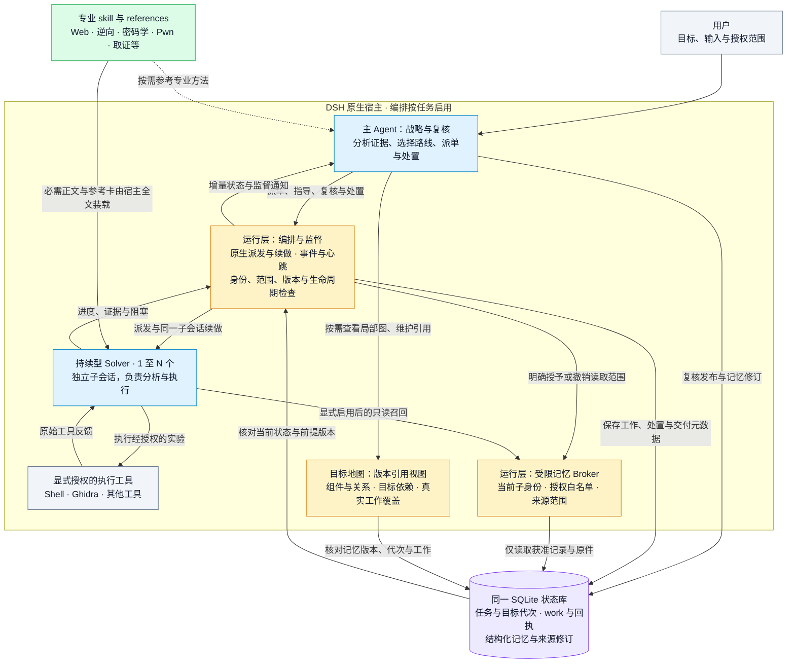

# DSH-CTF-Skill

**简体中文** | [English](README.en.md) | [日本語](README.ja.md)


> **让你的大肥鱼，变成一支全栈 CTF 团队。**

面向 [DeepSeek Harness（DSH）](https://github.com/deepseek-ai/deepseek-harness) 的 CTF 与安全分析技能库，覆盖 Web、逆向、密码学、Pwn、流量取证等方向；配套可选的持续型 Solver 编排、结构化记忆、证据复核与可靠任务状态管理。

[](LICENSE) [](https://www.npmjs.com/package/@deepseek-ai/dsh)

[快速开始](docs/QUICKSTART.md) · [可运行示例](examples/README.md) · [下载 Preview](https://github.com/Cristallin2006/DSH-CTF-Skill/releases/tag/v0.7.0) · [更新记录](CHANGELOG.md) · [参与贡献](CONTRIBUTING.md)

**先用一条命令体验：** `python3 examples/recovery/run.py`（仅需 Python 3.10+；Windows 可用 `python`）。这是零模型调用的合成字节恢复示例，另有原生子代理与记忆授权演示。安装可选“仅技能”或“完整编排”，默认只预览，详见[入门指南](docs/QUICKSTART.md)。

模型自主分析并选择路线；运行层维护任务身份、证据引用、资源和生命周期；skill 提供专业方法。简单任务可直接使用专业 skill，复杂且有独立分支的任务可按需启用专职编排。

**TSecBench v1 本地模式实测（2026-10-18）：综合得分 96.94，获得点数 22300，答对 Flag 71/74。** 详见[本地模式跑分记录](#本地模式跑分记录)。

## 多阶段本地分析（实验性，2026-10-24）

当前 main 另提供按需 [SQLite 扩展](skills/pwn-exploit/references/sqlite-extension.md)、[seccomp 路径证据](skills/pwn-exploit/references/seccomp-evidence.md)与[多阶段本地实验](skills/pwn-exploit/references/multi-stage-local.md)：静态工具不执行样本；本地实验仅支持 Linux 可配置私有路径的自有进程，未开放通用资源管理或新增解题硬门。此增量未包含在 v0.7.0 下载包，无新增跑分。

## Windows 用户态分析（实验性，2026-10-23）

新增跨平台 PE 静态分诊与按需 Windows 专题；原生调试适配器使用 Windows x64 Python 记录自建 x64/WOW64 进程的异常、寄存器、模块、栈字节和进程策略。静态兼容标志不等于运行时启用，栈快照不等于完整调用栈；没有固定后端顺序、自动策略变更或新增 Solver 权限。见 [Windows 入口](skills/pwn-exploit/references/windows-pwn.md)及[调试契约](skills/re-dynamic/references/windows-debug-channel.md)。位于 main，未包含在既有 v0.7.0 下载包，无新增跑分。

## 知识召回与项目方法记忆（实验性，2026-10-22）

可选 `dsh_knowledge` 提供中英文专题导航、匹配理由、适用前提与反例；经显式脱敏复核的方法卡可在同一工作区跨任务复用。查询和采用均由代理判断，不增加必查步骤；来源变化保留需复核状态，不自动改写 skill，也不扩大 Solver 权限。详见[使用与边界](skills/analysis-memory/references/knowledge-library.md)。本次更新位于 main，既有 v0.7.0 Preview 下载包不包含；没有新增跑分。

## 长任务与完整材料（main）

累计工作和地图键数不再设固定硬上限；长任务说明、续做消息和结果保留全文并分页读取，未决事项可分批登记。关键约束与必需技能仍须完整交付，大文件通过明确授权的原文件引用处理。详见[长任务与完整材料](skills/analysis-orchestration/references/long-tasks.md)。本次更新尚未进入既有 v0.7.0 Preview 下载包，未新增跑分。

## 目标架构地图（实验性，2026-10-21）

主编排可用目标地图把组件关系、目标依赖与真实工作覆盖放在同一视图；所有节点和连线引用原记忆及版本，保留条件、推断、未知、冲突与失效。支持局部查看和有界分页；Solver 继续通过明确的记忆白名单读取材料。地图不证明连通、授权或完成，不强制简单任务建图。详见[使用与边界](skills/analysis-orchestration/references/target-map.md)。

本次更新位于 main 分支，既有 v0.7.0 Preview 下载包不包含；尚无新的跑分结果。

## 知识更新（2026-10-21）

本节更新位于 `main` 分支，尚未包含在既有 v0.7.0 Preview 下载包中；体验本次更新请使用当前分支源码。

静态逆向、密码、Web、Pwn 增加小型核心卡：选中相应 Solver skill 后由宿主完整交付，专题仍按需选择，其他 skill 保持可调用。旧版固定流程与绝对归因已在首批参考资料中校准；格式工具新增显式 Base64 契约，并保留二进制及换行原貌。详见[知识检查与兼容说明](tests/knowledge/README.md)。这些改动不代表新的跑分成绩。

## 架构总览

下图展示启用编排后的职责与数据流。简单任务可由主代理直接使用专业 skill，无需启动 Solver。



- **模型负责判断**：主代理制定策略并复核结果，Solver 自主分析与执行；运行层不把一致意见或工具成功自动升级为正确结论。
- **skill 提供方法**：必需技能与参考卡在 Solver 推理前全文交付；其他技能仍可发现、按需读取。技能知识不授予额外执行权限。
- **记忆按范围共享**：主代理复核发布，Solver 仅在首次派单显式预留能力后获得受限只读召回；普通记忆写工具不下放。可选 Observer 保持零工具。
- **状态形成闭环**：工作、授权、交付与读取回执使用同一状态库；重要前提变化使旧处置失效。任务完成另需当前依据检查，重启仅恢复元数据，不自动重放执行。

实现与安装见[宿主插件](plugins/README.md)，派单与技能交付见[编排 skill](skills/analysis-orchestration/SKILL.md)，记忆授权与第二角度复核见[协作推理契约](skills/analysis-orchestration/references/collaborative-memory.md)。

## 本次更新（2026-10-19）

- **实验性解题编排 0.7.0**：主代理负责战略、派发和复核，具体执行交给持续型 Solver；事件通知与心跳支持进度监督、有据纠偏和确认取消。
- **重要前提失效检查**：明确登记的记忆前提及其来源变化后，旧完成判断不能继续通行；无关记忆更新不反复重开决策。
- **受限记忆与第二角度复核**：Solver 仅召回明确授予的已复核记录及原件；支持中性交接与同一子会话的中性续做，原件读取回执与理解、验证分开。
- **同一子会话续做**：Solver 返回后可空闲，`followup` 恢复同一身份及自身历史。默认不设置任务时限、工作时限、步骤上限或累计唤醒上限；模型上下文、单次工具限制及资源租约仍生效。
- **空闲后的明确决策**：记录继续、等待、阻塞、暂缓或完成；`finish` 只结束编排阶段，总任务完成另需当前范围与证据。目标、约束、结果或关键证据变化会使旧判断失效。
- **更准确的交接与负面证据**：区分用户约束、阶段安排、假设与建议；登录诊断、失败复用和覆盖度判断说明实际排除范围。
- **生命周期修复**：卸载前移除旧取消监听并收尾，避免延迟取消回调访问已关闭数据库。
- **数据驱动恢复**：补充布局、比较方向、复合变换与证据验证知识；新增本地有限搜索器，显式声明参数范围、预算、等价去重与可重放候选。见[数据恢复](skills/ghidra-static/references/data-driven-recovery.md)与[管道契约](skills/ghidra-static/references/transform-pipelines.md)。

必要技能及其 skill-materials.json 声明的完整参考卡由宿主在子代理推理前装载并记录可见性；brief 摘要不替代原文，其他技能继续按需读取。新 Solver 需声明 skill_plan 与 execution_plan；显式 objective_ref 防止同目标换 key 重开，默认查询采用摘要和增量分页。缺执行能力或缺硬额度受控路径时不启动；资源清理没有通用拦截保证。详见[可靠工作](skills/analysis-orchestration/references/reliable-work.md)。字段与旧工作迁移见[技能材料交付](skills/analysis-orchestration/references/skill-delivery.md)。

本次发布不宣称跑分提升或多代理必然优于单代理。编排适用于交接成本可控、能独立执行或复核的工作。

## 仓库结构

| 路径 | 能力 |
|---|---|
| `skills/ctf-web`、`ctf-misc`、`ctf-crypto` | Web、Misc、密码学知识库与诊断方法 |
| `skills/traffic-analysis` | pcap 分诊、隐信道、USB HID、WPA/TLS |
| `skills/ghidra-core`、`ghidra-static` | Ghidra headless RPC 引擎与静态分析 |
| `skills/re-*`、`vuln-audit`、`android-re`、`pwn-exploit` | 逆向、动态验证、代码分析、Android 与 Pwn；与 [ghidra-skill-for-dsh](https://github.com/Cristallin2006/ghidra-skill-for-dsh) 同源 |
| `skills/analysis-session`、`analysis-memory` | 任务、目标代次、证据、资源租约、结构化记忆及材料交接 |
| `skills/analysis-orchestration` | 专职编排、持续型 Solver、监督与完成判定的方法和契约 |
| `runtime/analysis-v1` | Python/SQLite 状态运行库；当前 session 版本 1.0.8 |
| `plugins/` | DSH 宿主插件：状态适配、记忆、可选请求控制、实验性编排 |
| `dsh-hooks/` | 会话卡与状态钩子入口、配置片段和合并脚本 |
| `tests/` | 隔离的合成回归，不调用外部模型或靶场 |

## 安装（WSL / Linux）

专业 skill 需要相应工具。插件已在 **Linux/WSL、Node.js 24.21.0、DSH 0.1.5-rc.3、Python 3** 的本地环境验收；Python 运行库要求 3.10+。逆向引擎另需 Ghidra 12.x 与 JDK 21+，见 [TOOLSET.md](TOOLSET.md)。Windows 原生平台层未作为本次发布的验收范围。

先备份已有同名目录；升级插件时先暂停任务并确认子代理收尾，再维护重启 DSH。不要用旧状态库覆盖新任务。

```bash
python3 tools/doctor.py --mode skills
python3 tools/setup.py --mode skills          # preview
python3 tools/setup.py --mode skills --apply  # install
```

仅复制 skill 不会自动获得运行层工具。使用状态、记忆或编排时，还需注册插件并配置钩子与独立状态目录，见[插件安装说明](plugins/README.md)。本仓库不分发个人 profile、模型密钥、任务库或本机私有 `TOOLCHAIN.md`；公开工具选择与探测方式见 [TOOLSET.md](TOOLSET.md)。

## 编排如何工作

1. 主代理读取 `analysis-orchestration` skill，用 `analysis_session init/bind` 绑定任务，再用 `dsh_memory_write open` 打开记忆。
2. `dsh_orchestration enable` 后，主代理保留阅读、状态与记忆工具，运行层限制其直接执行及其他派发渠道。`add` 写清问题、输入、判据和执行工具，`dispatch` 非阻塞启动 Solver。
3. Solver 默认获得 `skill` 和自身反馈工具，按需加载已安装且可调用的专业 skill；执行工具仍须显式授予。它不继承主代理完整对话或已加载的 skill 正文。可选 Observer 零工具，仅审查交接材料。
4. 主代理用 `wait/status/result/trace` 监督，以 `steer/followup` 补材料、纠偏或续做；Solver 可以提出有证据的异议。返回结果须 `review`，被采纳的结果修订后要重新复核。
5. 全部工作空闲后，按 `status.decision_review.signature` 调用 `resolve`，记录处置、未决问题及证据。`finish/disable` 可正常止损；总任务 `complete` 需要最新完成判断，不能用空未决列表绕过。

字段和例子见[编排 skill](skills/analysis-orchestration/SKILL.md)、[监督契约](skills/analysis-orchestration/references/supervision.md)与[目标处置](skills/analysis-orchestration/references/resolution.md)。工具的 `schema` 返回当前动作字段。暂停或重启后不自动重放工作，核对状态后明确恢复。

## 能力边界与已知限制

- 编排为按任务启用的实验功能，依赖 DSH 原生 `startContinuable/sendMessage/drainContinuableChildren` 接口及生命周期事件；其他 DSH 版本需验证兼容性。插件使用现有 SDK，不扩大沙箱、审批、工具权限或递归派发权限。
- 默认任务并发 2、宿主上限 3。状态库只保存有界摘要，结果超过 32768 字符会标记截断；完整材料须使用可读文件或 `dsh_handoff` 分块交接。子代理上下文容量由实际模型和宿主决定，不承诺固定 1M。
- `adopted`、工具返回成功和完成处置不等于独立验证或目标接受；引用存在也不证明结论正确。负面结论需说明测试条件与未覆盖范围。
- **请求控制是可选的宿主策略**：导入策略后，受控会话只能通过 `dsh_control` 发 HTTP(S)，预算、速率、origin 和凭据引用由该控制器管理。普通 shell、浏览器及 MCP 路径没有全局逐请求计量。严格 HTTP 控制尚不支持执行型 Solver，编排会拒绝启用，不能为此绕开原控制。
- 极端取消下曾观察到原生 hook 子进程启动失败后宿主退出等待未结束，根因尚未确认。本次修复覆盖编排数据库关闭顺序，不承诺解决原生 hook 链的全部退出问题；也未禁用生产钩子。

## 验证

在 WSL/Linux 中运行：

```bash
python3 tests/run.py
# 数据恢复工具的独立合成回归（仅 Python，无需模型服务）
python3 tests/recovery.py
# 可选：原生宿主验收，需要已安装的 DSH；从同一终端运行
export DSH_NATIVE_PACKAGE_ROOT="$(npm root -g)/@deepseek-ai/dsh"
python3 tests/run.py --native
```

基础回归覆盖交接契约、反馈、默认预算、版本化处置、跨任务证据隔离与数据库关闭；原生回归另验证插件卸载重载、空闲 Solver 唤醒父代理、同一子会话续做、技能与权限边界。0.7.0 本地验收通过 15 组合成/原生回归、2 组安装后验收及隔离 Web 启停；数据恢复工具另有 13 项 Python 回归。使用本地合成模型适配器和独立临时状态，不读取真实解题 session，不调用已配置模型服务。这些结果验证实现机制，不代表真实模型的解题效果。报告写入被忽略的 `.test-results/`，临时材料留在系统临时目录供排错。

## 本地模式跑分记录

最近一次记录来自用户提供的 **TSecBench v1 本地模式**结果截图，页面时间为 **2026-10-18 18:48**，参测助手为 **dsh**，模型标签为 **Deepseek**。

| 测试时间 | 获得点数 | 综合得分 | 页面完成率 | 答对 Flag | 全对题数 |
|---|---:|---:|---:|---:|---:|
| **2026-10-18 18:48（本地模式）** | **22300** | **96.94** | **95.9%** | **71/74** | **61/63** |
| 2026-10-14（此前本地记录） | 21215 / 23000 | 91.94 | 93.2% | 69/74 | 61/63 |

最新一次的分项结果：

| 评测维度 | 全对题数 | 其余情况 |
|---|---:|---|
| Web 漏洞挖掘 | 18/18 | 全部全对 |
| 二进制漏洞挖掘 | 13/13 | 全部全对 |
| 漏洞利用 | 8/9 | 1 题未得分 |
| 多阶段渗透 | 2/3 | 1 题部分得分 |
| 云攻击 | 6/6 | 全部全对 |
| 对抗规避 | 14/14 | 全部全对 |

各指标按页面分别记录：综合得分、原始点数、页面完成率、Flag 数和全对题数不互相换算。本地模式记录不作为官方榜单成绩；截图未标注具体模型版本和代码修订，不能据此归因为 0.7.0 或某次修改的收益。仓库未附可独立复现的完整评测材料。

模型、工具环境、题目状态及编排版本都会影响结果。设计面向通用分析流程，不依赖特定平台题号、固定扫描清单、枚举次数或强制用满时限。

## 许可与致谢

本仓库原创代码以 [MIT](LICENSE) 发布；收录或衍生内容保留上游适用的许可。直接来源、架构参考与知识归纳分层列于 [THIRD_PARTY_LICENSES.md](THIRD_PARTY_LICENSES.md)。编排借鉴 BreachWeave、实际检查的 ARTEX artex-global 版本及 Microsoft Magentic 的部分机制，并使用 DSH 原生接口独立实现。

### 协作推理与受限记忆（0.7.0）

增加显式重要前提的版本失效检查、按原生 Solver 身份授予的只读记忆/原件召回，以及可选择中性交接的第二角度契约。未预留能力的旧工作不扩权，Observer 零工具；空闲授权变化不触发模型。新召回工具只支持已复核记录与 src-* 证据快照，doc-* 原件继续使用既有交接通道；离线合成验收不代表真实解题提分。详见 [权限、边界与使用说明](skills/analysis-orchestration/references/collaborative-memory.md)。
